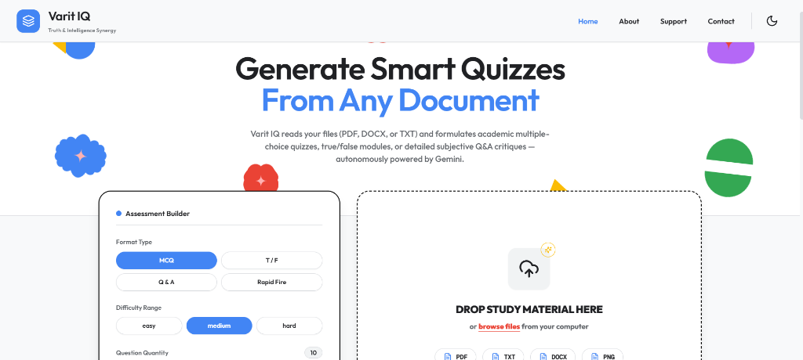
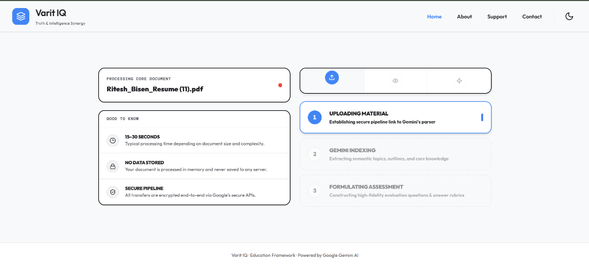
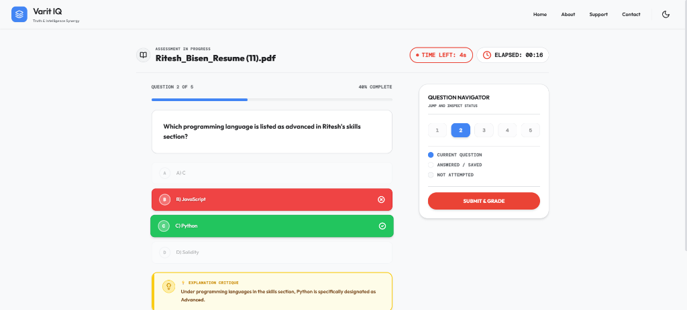
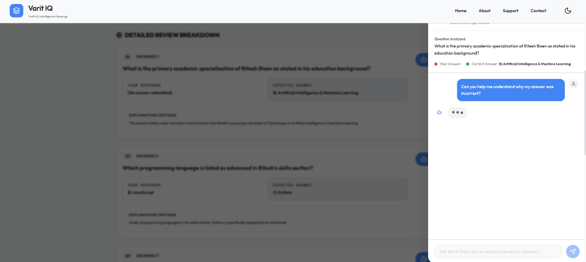
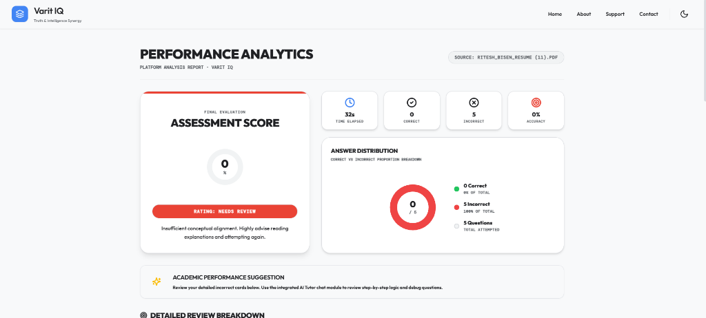
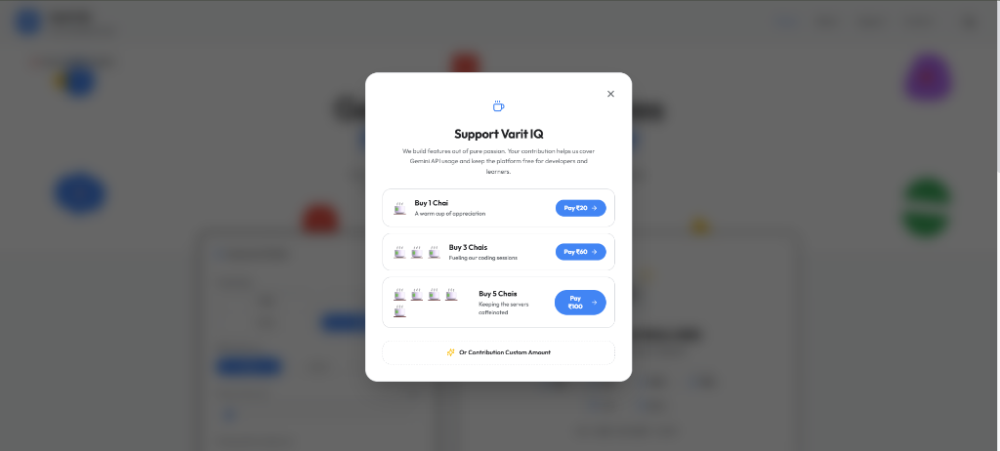
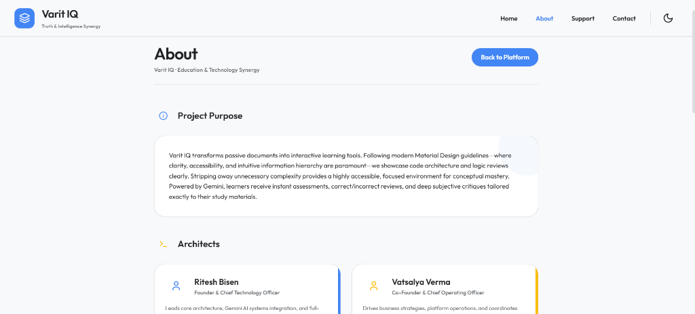
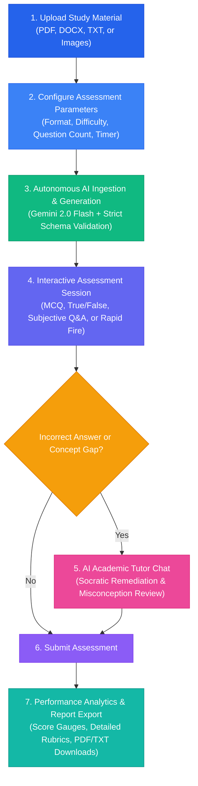
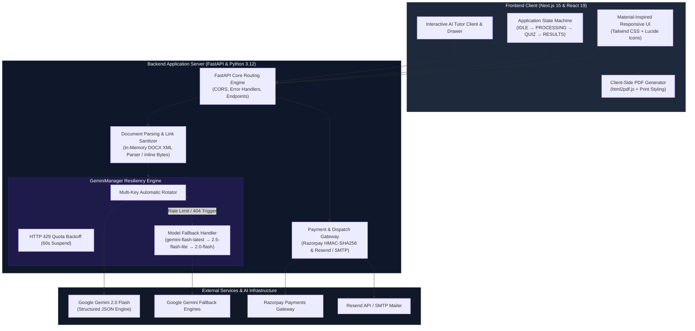

<div align="center">

# 🧠 Varit IQ
### **Truth and Intelligence Synergy**

**Autonomous, AI-Powered Assessment Generation & Personalized Mastery Platform**

[](https://varitiq.in)
[](https://aistudio.google.com/)
[](https://fastapi.tiangolo.com/)
[](https://nextjs.org/)
[](https://www.typescriptlang.org/)
[](LICENSE)

<br />

```
Upload Any Study Material ──► Choose Assessment Format ──► AI Evaluates & Teaches ──► Actionable Analytics
```

<br />

[Explore Live Platform](https://varitiq.in) • [Watch Demo Video](#-live-product-and-important-links) • [View Architecture](#-system-architecture) • [Key Features](#-key-features) • [Platform Showcase](#-platform-screenshots--visual-showcase) • [Contact Support](#-contact-and-support)

---

</div>

## 📌 Executive Summary

**Varit IQ** is an intelligent, autonomous assessment-generation and interactive learning platform engineered to bridge the gap between static study material and deep conceptual mastery. Built around Google's state-of-the-art **Gemini 2.0 Flash** engine, Varit IQ transforms arbitrary study materials—including complex lecture notes, syllabi, textbooks, and problem sets in PDF, DOCX, TXT, or image formats—into rigorous, multi-format assessments in under 10 seconds.

Traditional assessment generation is labor-intensive for educators and often leaves learners stranded with generic, one-size-fits-all question banks that fail to match their specific curricula. Varit IQ automates the entire evaluation lifecycle: from schema-constrained question synthesis (Multiple Choice, True/False, Subjective Q&A with rubrics, and Rapid Fire) to real-time interactive remediation via an embedded **AI Academic Tutor** and print-ready analytics reporting.

---

## 🎯 Quick Navigation & Important Links

| Resource | Link / Access |
| :--- | :--- |
| 🌐 **Live Deployed Platform** | [https://varitiq.in](https://varitiq.in) |
| 🎬 **Product Demo Video** | [INSERT GOOGLE DRIVE DEMO VIDEO LINK HERE] |
| 📸 **Official Instagram** | [INSERT OFFICIAL VARIT IQ INSTAGRAM LINK HERE] |
| 💻 **GitHub Repository** | [https://github.com/RiteshBisen/Varit-IQ](https://github.com/RiteshBisen/Varit-IQ) |
| ✉️ **Official Support Email** | [INSERT OFFICIAL VARIT IQ SUPPORT EMAIL HERE] |

---

## 💡 The Problem Statement

In modern higher education, test preparation, and self-directed learning, students and educators encounter four fundamental roadblocks:

1. **The Assessment Authoring Bottleneck:**
   Educators and teaching assistants spend dozens of manual hours drafting quizzes, balancing difficulty levels, formatting distractors, and writing explanatory rationales for every topic.
2. **Generic, Disconnected Practice Material:**
   Commercial question banks frequently fail to mirror the specific textbooks, lecture slide decks, and professor-curated notes students are actively studying, leading to misaligned self-evaluation.
3. **Passive Reading vs. Active Recall Deficit:**
   Re-reading textbooks provides a false sense of fluency. Without immediate, targeted testing and objective feedback, conceptual blind spots remain hidden until high-stakes examinations.
4. **Lack of Instant Explanatory Remediation:**
   When a student answers an assessment question incorrectly, conventional quiz systems simply display a red mark and move on. Learners are left guessing why their mental model failed without a tutor to intervene at that exact moment.

---

## 🚀 The Varit IQ Solution

Varit IQ replaces passive reading and manual question authoring with an autonomous, high-speed evaluation ecosystem:

```
┌────────────────────────┐      ┌───────────────────────────┐      ┌─────────────────────────┐
│ User Learning Material │ ───► │  Varit IQ AI Engine       │ ───► │ Personalized Evaluation │
│ (PDF, DOCX, TXT, IMG)  │      │  (Gemini 2.0 Flash API)   │      │ (Multi-Format Quizzes)  │
└────────────────────────┘      └───────────────────────────┘      └────────────┬────────────┘
                                                                                │
                                                                                ▼
┌────────────────────────┐      ┌───────────────────────────┐      ┌─────────────────────────┐
│ Verified Mastery &     │ ◄─── │  Performance Analytics &  │ ◄─── │ 24/7 Contextual Tutor   │
│ Print-Ready Reports    │      │  Subjective Rubric Audit  │      │ (Interactive Dialogue)  │
└────────────────────────┘      └───────────────────────────┘      └─────────────────────────┘
```

- **Curriculum-Locked Assessment:** Every generated question originates strictly from the user's uploaded document, eliminating irrelevant trivia.
- **Multi-Format Synthesis:** Generates Multiple Choice Questions (MCQs), True/False checks, Subjective Q&A with concept rubrics, or Rapid Fire timed drills.
- **Embedded AI Academic Tutor:** Immediate, conversational feedback for incorrect answers to guide the learner through the underlying logic rather than merely spoiling the answer.
- **Autonomous Subjective Evaluation:** An automated rubric checker grades free-form written answers on a 0–100 scale, points out missing key concepts, and provides model answers.

---

## ✨ Key Features & Capabilities

### 1. Multi-Format Assessment Engine
- **Multiple Choice Questions (MCQs):** Generates 4 plausible options (A, B, C, D) per question with distractor rationale and conceptual explanations.
- **True / False Modules:** Quick conceptual verification checks to test edge cases and fundamental definitions.
- **Subjective Q&A with AI Rubric Grading:** Students draft written answers that are graded on a 0–100 scale against expected answers and key rubric concepts, highlighting omitted points and offering tailored improvement suggestions.
- **Rapid Fire Mode:** High-tempo drill mode with a per-question 10-second timer to reinforce cognitive recall under pressure.

### 2. Multi-Format Document Ingestion
- Native support for **PDF**, **DOCX** (parsed in-memory via pure Python XML/ZIP parsing without external heavy dependencies), **DOC**, **TXT**, and **Images** (`image/png`, `image/jpeg`, `image/webp`).
- Accommodates documents up to **20 MB**.
- **Automated Text Sanitization & Link Filtering:** Ingested documents are cleansed of hyperlinks and URLs to prevent model hallucination and focus strictly on academic principles.

### 3. Granular Assessment Customization
- **Difficulty Calibration:** Toggle between `Easy`, `Medium`, and `Hard` modes to calibrate question complexity and depth.
- **Question Quantity Selector:** Flexible slider control from 5 to 20 questions per session.
- **Challenge Session Timer:** Optional session countdown (`Off`, `5 min`, `10 min`, `15 min`, `20 min`, or `Custom` up to 180 minutes) with automatic submission upon timer expiration and `sessionStorage` recovery.

### 4. Embedded 24/7 AI Academic Tutor
- Context-aware conversational side-drawer powered by Gemini.
- Automatically initializes whenever a student selects an incorrect answer.
- Guides students toward understanding the core rationale through Socratic inquiry without simply giving away solutions.

### 5. Comprehensive Performance Analytics & Reporting
- **Visual Circular Score Gauge:** Instant percentage score, accuracy distribution (correct, incorrect, skipped), and time metrics.
- **Performance Rating Tiers:** Calibrated feedback categories (`Mastery`, `Competent`, `Developing`, `Needs Review`).
- **One-Click Export:** Download performance reports as formatted **Plain Text (.txt)** or clean, multi-page **PDF documents** styled with automated page-break avoidance (`html2pdf.js`).

### 6. Resilient Infrastructure & Community Support
- **Multi-Key Gemini Failover:** Dynamic key rotation with automatic 60-second backoff on HTTP 429 rate limits, invalid key isolation, and model fallback chains (`gemini-flash-latest` → `gemini-2.5-flash-lite` → `gemini-2.0-flash`).
- **Community Micro-Contributions:** Integrated Razorpay "Buy Us a Chai" support modal with HMAC-SHA256 signature verification and automated mock fallback.
- **Community Support Metrics:** Live tracking benchmarks displaying community contributions, chais funded, and supporter totals.
- **Direct Support & Feedback Hub:** Multi-category contact portal (Feature Request, Bug Report, General Query, Partnership, Feedback) dispatched via Resend API or SMTP mail transport.
- **Modern Material Design UI:** Responsive dark/light theme toggle, glassmorphism accents, and accessible contrast compliance.

---

## 📊 Varit IQ vs. Conventional Quiz Tools

| Feature Dimension | Varit IQ | Typical AI Quiz Generators |
| :--- | :--- | :--- |
| **Source Grounding** | **Strictly locked to your uploaded study material** | Frequently pulls ungrounded generic web trivia |
| **Supported File Formats** | **PDF, DOCX, DOC, TXT, PNG, JPG, WEBP** | Mostly PDF-only or raw text paste |
| **Assessment Variety** | **MCQ, True/False, Subjective Q&A, Rapid Fire** | Single format (typically MCQs only) |
| **Subjective Grading** | **Automated 0–100 score + rubric checks + missing concepts** | Unsupported or uncalibrated text summary |
| **Active Remediation** | **Built-in Socratic AI Tutor side-drawer per question** | Static text explanation only |
| **Difficulty & Length Control** | **Granular difficulty + 5–20 question range + timers** | Fixed presets with rigid limits |
| **Document Privacy** | **In-memory processing, zero permanent server storage** | Files stored on third-party databases |
| **Report Exporting** | **One-click Plain Text & Print-Ready PDF export** | Copy-paste only or paywalled export |
| **API Resilience** | **Multi-key rotation + quota backoff + model fallback** | Single key prone to sudden rate-limit crashes |

---

## 🖼️ Platform Screenshots & Visual Showcase

> High-resolution product captures illustrating the complete Varit IQ end-to-end user workflow: from document ingestion and real-time processing to interactive assessment, AI tutoring, and performance analytics.

<br />

### 1. Homepage / Landing Page
**Caption: Varit IQ – AI-Powered Learning and Assessment Platform**


<!-- Screenshot Asset: assets/01-varitiq-homepage.png -->

The landing interface features a clean, Google Material-inspired aesthetic designed for cognitive clarity and distraction-free operation. Users are greeted with an intuitive **Assessment Builder** on the left where they can customize their assessment format (Multiple Choice, True/False, Subjective Q&A, or Rapid Fire), configure the difficulty range (`Easy`, `Medium`, `Hard`), and choose the exact question quantity (5 to 20 questions via a dynamic slider). On the right, a prominent drag-and-drop ingestion zone accepts study documents across multiple formats (PDF, TXT, DOCX, PNG) for immediate parsing.

---

### 2. Uploaded Document Analysis
**Caption: Smart Document Processing**


<!-- Screenshot Asset: assets/02-smart-document-processing.png -->

Once a user uploads their study material, Varit IQ transitions into an automated, transparent document analysis view. The interface displays the active document name (e.g., `Ritesh_Bisen_Resume (11).pdf`) alongside critical operational guarantees: typical processing duration (15–30 seconds), a zero-permanent-storage data privacy pledge (in-memory processing with automatic buffer clearing), and end-to-end encrypted transfer via Google's secure APIs. A synchronized 3-step live processing indicator guides the user through material upload, Gemini indexing/topic extraction, and final question/rubric formulation.

---

### 3. Interactive Quiz Interface
**Caption: Interactive Assessments with Instant Feedback**


<!-- Screenshot Asset: assets/03-interactive-quiz.png -->

The quiz-taking interface delivers an active, high-engagement testing experience. As learners select options, Varit IQ provides instantaneous visual validation: incorrect choices are highlighted in prominent red with a cancellation badge, while the correct answer is illuminated in vibrant green with a verified checkmark. Immediately beneath the options, an **Explanation Critique** container displays the factual rationale directly extracted from the source material. A live countdown timer, elapsed timer, question progress bar, and interactive **Question Navigator** provide full navigation control and pacing awareness.

---

### 4. AI-Powered Learning Chatbot
**Caption: AI Learning Assistant**


<!-- Screenshot Asset: assets/04-ai-learning-assistant.png -->

When a student struggles with a concept or answers incorrectly, the embedded **AI Learning Assistant** opens seamlessly as a context-aware side-drawer. Rather than merely revealing the answer, the assistant analyzes the exact question, the student's submission, and the target concept to engage in interactive Socratic dialogue. Learners can ask open-ended questions (e.g., *"Can you help me understand why my answer was incorrect?"*), receive customized step-by-step reasoning, debug conceptual misconceptions, and solidify topic mastery before proceeding.

---

### 5. Performance Analytics
**Caption: Performance Analytics & Personalised Feedback**


<!-- Screenshot Asset: assets/05-performance-analytics.png -->

Upon assessment completion, learners receive a comprehensive performance evaluation report. The analytics suite highlights the student's overall assessment score via a circular visual gauge, paired with an objective performance classification (e.g., `Rating: Needs Review`, `Developing`, `Competent`, or `Mastery`). Key performance metrics—including total elapsed time, correct count, incorrect count, and accuracy percentage—are accompanied by an answer distribution chart and actionable **Academic Performance Suggestions** advising the learner on which conceptual areas require targeted remediation.

---

### 6. Developer Support Feature
**Caption: Community & Developer Support**


<!-- Screenshot Asset: assets/06-developer-support.png -->

The Community & Developer Support interface provides an open bridge between users and the team behind Varit IQ. As demonstrated in the live modal, learners and educators can support ongoing platform development through voluntary micro-contributions (*"Buy a Chai"* at ₹20, ₹60, ₹100, or custom amounts via Razorpay) to help offset Gemini API usage costs and keep the platform free and accessible. The module also serves as a direct channel for users to provide feedback, report issues, and collaborate with the developers.

---

### 7. About Varit IQ / Our Team
**Caption: About Varit IQ – Our Vision & Team**


<!-- Screenshot Asset: assets/07-about-team.png -->

The About view communicates the foundational purpose, pedagogical vision, and leadership behind Varit IQ. It articulates the platform's core commitment to transforming passive reading into active, distraction-free mastery following modern Material Design principles. The section introduces the architects behind the product—Founder & Chief Technology Officer **Ritesh Bisen** and Co-Founder & Chief Operating Officer **Vatsalya Verma**—detailing their respective responsibilities in core architecture, Gemini AI integration, business strategy, and educational synergy.

---

## 🔄 How It Works

Varit IQ simplifies assessment creation into a streamlined four-step workflow:



### Detailed Process Breakdown

1. **Upload & Sanitize:** The user drops a document (PDF, Word DOCX, text file, or image) into the dropzone. Plaintext and DOCX files are extracted in-memory; PDFs and images are processed as byte buffers. All external hyperlinks and URLs are systematically stripped to ensure distraction-free, hallucination-resistant processing.
2. **Parameter Selection:** The user defines the assessment parameters:
   - **Format:** Multiple Choice (MCQ), True/False (T/F), Subjective (Q&A), or Rapid Fire.
   - **Difficulty:** Easy, Medium, or Hard.
   - **Count:** 5 to 20 questions.
   - **Challenge Timer:** Untimed, 5/10/15/20 min presets, or custom minutes.
3. **Gemini Ingestion & Schema Enforcement:** The FastAPI backend dispatches the payload to Google Gemini 2.0 Flash using strict Pydantic data schemas (`response_schema=list[Question]`), ensuring 100% deterministic, type-safe JSON returns without prompt degradation.
4. **Interactive Practice & Tutoring:** The student completes the quiz. For MCQs and True/False questions, immediate feedback reveals correct answers with detailed reasoning. If an answer is incorrect, the student can launch the **AI Tutor** drawer to debug their reasoning. For Subjective Q&A, answers are evaluated against detailed rubrics.
5. **Analytics & Export:** Upon completion, the student receives a comprehensive score breakdown, time analysis, mastery classification, and the ability to download a persistent PDF or text report.

---

## 🏗️ System Architecture

Varit IQ is engineered with a decoupled, modular architecture adhering to modern clean-code principles:



### Architectural Highlights

- **Stateless, Ephemeral Data Flow:** To preserve user privacy and maintain low operational complexity, uploaded documents are processed in-memory and are never written to permanent disk storage or databases.
- **Strict Typing Across the Stack:** Data models are mirrored across Python Pydantic models on the backend and TypeScript interfaces on the frontend, eliminating payload contract mismatch.
- **Fail-Safe AI Resiliency:** The custom `GeminiManager` continuously monitors API health. When hitting quota bottlenecks or transient upstream hiccups, requests automatically transition through secondary keys and backup models without disrupting the end user.

---

## 🛠️ Technology Stack

Only battle-tested technologies and verified packages are utilized across the Varit IQ stack:

### Frontend Ecosystem
| Technology | Badge | Purpose |
| :--- | :--- | :--- |
| **Next.js 15** | `next@15.3.8` | App Router architecture, server-side performance, modern hydration |
| **React 19** | `react@19.0.0` | Core declarative UI component layer |
| **TypeScript 5** | `typescript@5.x` | Strict type safety across client states and API contracts |
| **Tailwind CSS 3** | `tailwindcss@3.4.17` | Utility-first, responsive, and accessible design system |
| **Framer Motion** | `framer-motion@12.6.5` | Smooth layout transitions, animated state changes, and progress orbs |
| **html2pdf.js** | `html2pdf.js@0.14.0` | Client-side, print-styled PDF report compilation |
| **react-dropzone** | `react-dropzone@14.3.5` | Multi-format drag-and-drop file ingestion with validation |
| **Sonner** | `sonner@2.0.3` | Modern, responsive toast notifications |
| **Lucide React** | `lucide-react@0.503.0` | Clean, accessible iconography |

### Backend Ecosystem
| Technology | Badge | Purpose |
| :--- | :--- | :--- |
| **FastAPI** | `fastapi@0.115.6` | Asynchronous, high-throughput Python REST API framework |
| **Uvicorn** | `uvicorn@0.32.1` | Lightning-fast ASGI production web server |
| **Python 3.12** | `python@3.12+` | Modern backend runtime with native asynchronous primitives |
| **Pydantic v2** | `pydantic@2.10.6` | Robust data validation and JSON schema generation |
| **Python Multipart** | `python-multipart@0.0.20` | Streaming multipart file uploads |
| **Python Dotenv** | `python-dotenv@1.0.1` | Local and production environment configuration management |

### Artificial Intelligence & Third-Party Integrations
| Service / API | Integration Scope |
| :--- | :--- |
| **Google Gemini 2.0 Flash** | Primary AI engine for document comprehension, question formulation, and tutor chat |
| **Google GenAI SDK (`google-genai`)** | Native SDK integration (`v1.10.0`) utilizing `response_schema` structured outputs |
| **Razorpay API** | Secure micro-contribution transactions with HMAC-SHA256 signature verification |
| **Resend API / SMTP** | Multi-channel email forwarding for customer queries, bug reports, and partnership inquiries |

---

## 👥 Target Audience & Key Use Cases

```
                    ┌───────────────────────────────────────────────┐
                    │               VARIT IQ ECOSYSTEM              │
                    └───────────────────────┬───────────────────────┘
                                            │
         ┌──────────────────┬───────────────┴───────────────┬──────────────────┐
         ▼                  ▼                               ▼                  ▼
┌─────────────────┐ ┌─────────────────┐           ┌──────────────────┐ ┌─────────────────┐
│ College/School  │ │ Competitive     │           │ Educators &      │ │ Self-Directed   │
│ Students        │ │ Exam Aspirants  │           │ TAs              │ │ Professionals   │
└─────────────────┘ └─────────────────┘           └──────────────────┘ └─────────────────┘
```

1. **University & High School Students:**
   - Convert lengthy syllabus chapters, lecture slide decks, and class notes into active review quizzes before midterms and finals.
   - Use the AI Tutor to understand difficult concepts without scheduling additional office hours.
2. **Competitive Exam Aspirants (GATE, GRE, UPSC, MCAT, SAT):**
   - Upload specialized subject papers or reference texts to generate high-difficulty assessments that mimic rigorous testing environments.
   - Utilize Rapid Fire mode to build quick recall speed under timed pressure.
3. **Educators, Professors & Teaching Assistants:**
   - Eliminate repetitive hours spent formulating exam questions, creating distractors, and writing rubrics.
   - Generate diverse question pools to evaluate whether course materials communicate core concepts effectively.
4. **Self-Paced Learners & Upskilling Professionals:**
   - Validate comprehension after finishing whitepapers, technical documentation, or industry textbooks.
   - Test retention with subjective questions to ensure actionable mastery of complex topics.

---

## 🗺️ Product Roadmap

### ✅ Phase 1: Core Foundation & Multi-Format Engine *(Completed / Live)*
- [x] Ingest PDF, DOCX, DOC, and TXT files up to 20MB.
- [x] Integrate Google Gemini 2.0 Flash with Pydantic structured schemas.
- [x] Multi-format generation: Multiple Choice (MCQ) & True/False questions.
- [x] Subjective Q&A generation with automated 0–100 rubric evaluations.
- [x] Rapid Fire drill mode with built-in 10-second per-question countdown.
- [x] Interactive AI Academic Tutor drawer for instant mistake remediation.
- [x] Session Challenge Timer with configurable intervals and `sessionStorage` protection.
- [x] One-click performance reporting with Plain Text (.txt) and styled PDF downloads.
- [x] Multi-key Gemini load rotation, 429 quota backoff, and model fallback chains.
- [x] Razorpay micro-contribution integration and community milestone counters.
- [x] Contact and support dispatch system via Resend API and SMTP fallback.
- [x] Material Design interface with responsive Dark and Light themes.

### 🟡 Phase 2: Collaboration & Enhanced Assessment *(In Progress)*
- [ ] Shareable assessment links enabling peers and study groups to take identical quizzes.
- [ ] Direct export of generated question sets to Quizlet, Anki (.apkg), and Google Forms.
- [ ] Persistent user assessment history utilizing encrypted local database storage.
- [ ] Extended document parser support for PowerPoint presentations (`.pptx`) and EPUB eBooks.

### 🔮 Phase 3: Institutional & Classroom Scaling *(Planned / Future Scope)*
- [ ] **LMS Integrations:** Direct sync plugins for Google Classroom, Canvas, and Moodle.
- [ ] **Classroom Analytics Dashboard:** Aggregate student performance analytics identifying cohort-wide concept deficiencies.
- [ ] **Audio Lecture Transcription to Quiz:** Ingest recorded audio lectures or YouTube URLs to formulate assessments automatically.
- [ ] **Adaptive Difficulty Engine:** Dynamic real-time difficulty adjustment where subsequent questions adapt based on live student accuracy.

---

## 🔗 Live Product and Important Links

Experience the platform live or inspect the project assets via the official links below:

1. **Live Platform:** [https://varitiq.in](https://varitiq.in)
2. **Product Demo Video:** [INSERT GOOGLE DRIVE DEMO VIDEO LINK HERE]
3. **Instagram:** [INSERT OFFICIAL VARIT IQ INSTAGRAM LINK HERE]
4. **GitHub Repository:** [https://github.com/RiteshBisen/Varit-IQ](https://github.com/RiteshBisen/Varit-IQ)

---

## 💼 Business Potential & Value Proposition

### 1. Significant Time & Labor Economics
In academic institutions and private coaching centers, authoring high-quality question banks costs hundreds of hours each semester. Varit IQ slashes this turnaround from days to seconds, allowing educators to allocate more time toward personalized instruction, mentoring, and student support.

### 2. High Architectural Scalability & Low Marginal Cost
- **Serverless & Edge-Ready Frontend:** Hosted on modern global edge networks (Vercel) delivering sub-100ms asset delivery worldwide.
- **Efficient Compute Backend:** FastAPI's asynchronous architecture handles high concurrent user requests with minimal memory overhead.
- **Optimized Token Economics:** By utilizing Gemini 2.0 Flash alongside strict JSON output constraints, Varit IQ minimizes token overhead, keeping inference costs exceptionally low compared to legacy LLM pipelines.

### 3. Monetization Pathways
- **B2C Freemium:** Generous free-tier assessment credits, with premium tiers unlocking higher file limits, unlimited subjective grading, and cloud quiz history.
- **B2B Campus & Institutional Licensing:** Providing colleges, test-prep institutes, and educators with team seats, custom branding, and classroom analytics dashboards.
- **LMS Plugin Marketplace:** Commercial add-ons integrating Varit IQ directly into Canvas, Blackboard, or Google Classroom.
- **Enterprise API Access:** Allowing corporate training and EdTech platforms to integrate Varit IQ's assessment engine into internal LMS workflows.

---

## 👥 Architects & Team

Varit IQ was conceived, architected, and built by passionate builders dedicated to transforming educational accessibility:

<br />

<div align="center">

| Architect | Role & Responsibilities | Profiles |
| :--- | :--- | :--- |
| **Ritesh Bisen** | **Founder & Chief Technology Officer (CTO)**<br />Leads core system architecture, Gemini AI systems integration, resilience engineering, and full-stack service design orchestration. | [](https://github.com/RiteshBisen) [](https://www.linkedin.com/in/ritesh-bisen-7b6bb7317/) [](https://www.instagram.com/riteshhbisen/) |
| **Vatsalya Verma** | **Co-Founder & Chief Operating Officer (COO)**<br />Drives business strategy, platform operations, educational outreach, user experience coordination, and ecosystem partnerships. | [](https://www.linkedin.com/in/vatsalya-verma-b45200241/) [](https://www.instagram.com/mr_vatsalya_09/) |

</div>

<br />

---

## 📞 Contact and Support

We welcome feedback, inquiries, bug reports, and partnership discussions:

- **Official Website:** [https://varitiq.in](https://varitiq.in)
- **Support Email:** [INSERT OFFICIAL VARIT IQ SUPPORT EMAIL HERE]
- **Instagram:** [INSERT OFFICIAL VARIT IQ INSTAGRAM LINK HERE]
- **Issue Tracker:** [GitHub Issues](https://github.com/RiteshBisen/Varit-IQ/issues)

---

## ⚡ Local Development Setup

To run Varit IQ locally for development and evaluation:

### Prerequisites
- **Python 3.12+**
- **Node.js 20+** (or npm / pnpm / bun)
- **Google Gemini API Key** ([Obtain one from Google AI Studio](https://aistudio.google.com/app/apikey))

### 1. Clone the Repository
```bash
git clone https://github.com/RiteshBisen/Varit-IQ.git
cd Varit-IQ
```

### 2. Backend Setup (FastAPI)
```bash
cd backend

# Create and activate virtual environment
python -m venv .venv
# On Windows:
.venv\Scripts\activate
# On Linux/macOS:
# source .venv/bin/activate

# Install dependencies
pip install -r requirements.txt

# Configure environment variables
cp .env.example .env
# Open .env and add your GOOGLE_API_KEY
```

**Run the backend server:**
```bash
uvicorn main:app --reload --port 8000
```
- API Base: `http://localhost:8000`
- Interactive Swagger Documentation: `http://localhost:8000/docs`

### 3. Frontend Setup (Next.js 15)
```bash
cd ../frontend

# Install packages
npm install

# Configure environment variables
cp .env.example .env.local
# Set NEXT_PUBLIC_API_URL=http://localhost:8000
```

**Run the development frontend:**
```bash
npm run dev
```
- Application Interface: `http://localhost:3000`

---

## 🔒 Privacy & Data Ethics

At Varit IQ, student data sovereignty and document privacy are foundational:
- **Zero Permanent Document Storage:** User-uploaded files are processed ephemerally in-memory or in temporary application buffers. Files are never stored on permanent database disks.
- **Immediate Resource Cleanup:** Document buffers are garbage-collected immediately upon assessment synthesis.
- **Strict Network Isolation:** Backend CORS middleware explicitly whitelists trusted domains (`varitiq.in` and local development instances), guarding against unauthorized cross-origin requests.

---

## 🌟 Closing Vision

> **"Education is not the learning of facts, but the training of the mind to think."**
> — Albert Einstein

**Varit IQ** is committed to democratizing high-quality, personalized evaluation. By harmonizing state-of-the-art generative intelligence with rigorous pedagogical principles, we empower every learner to test with precision, learn from mistakes in real time, and turn every study document into a stepping stone toward mastery.

<br />

<div align="center">

**Varit IQ — Truth and Intelligence Synergy**
<br />
<sub>Crafted with passion for learners and educators worldwide.</sub>

</div>
